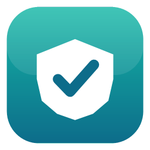
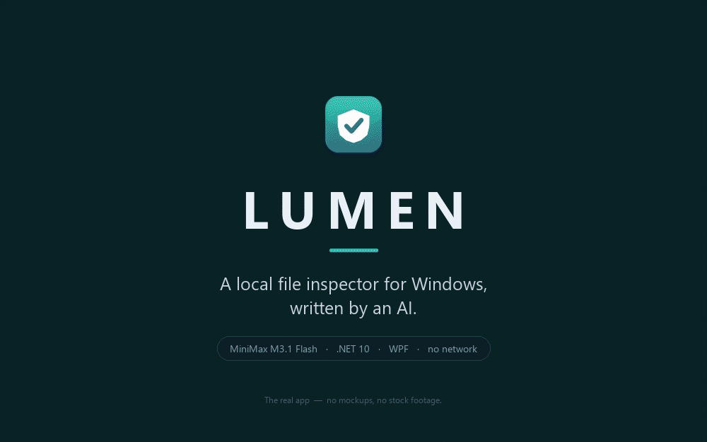
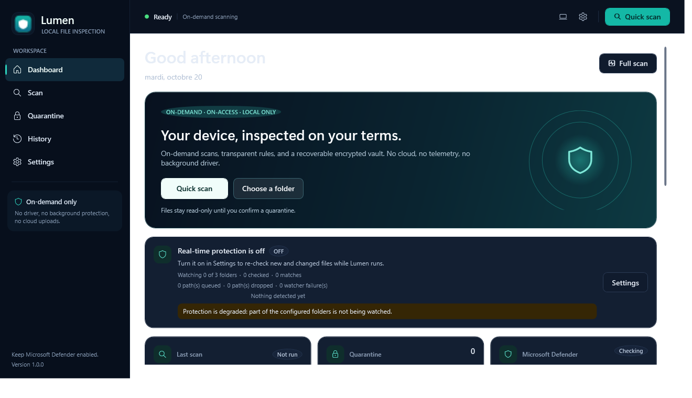
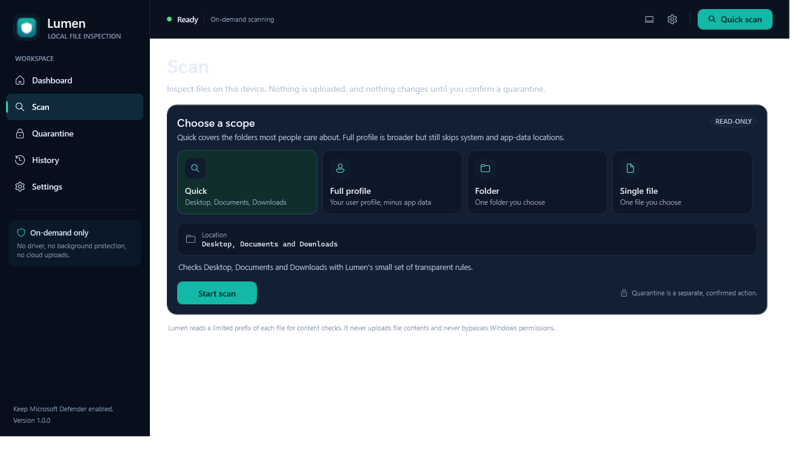
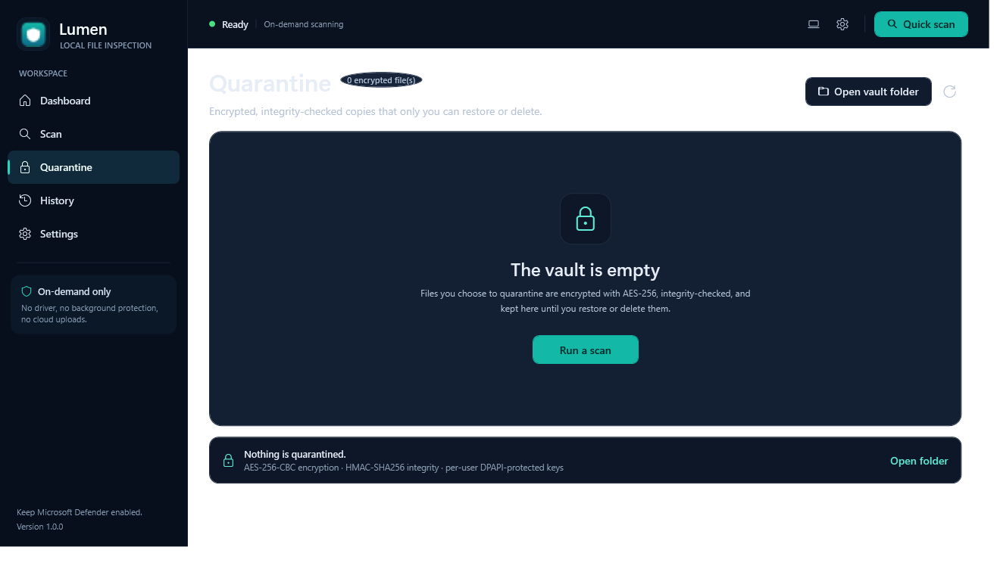
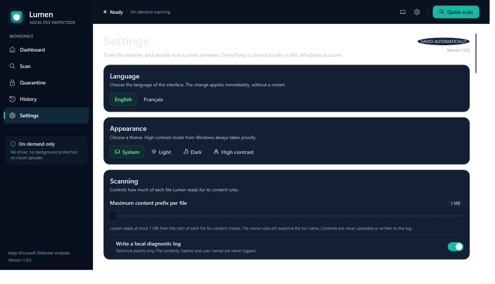
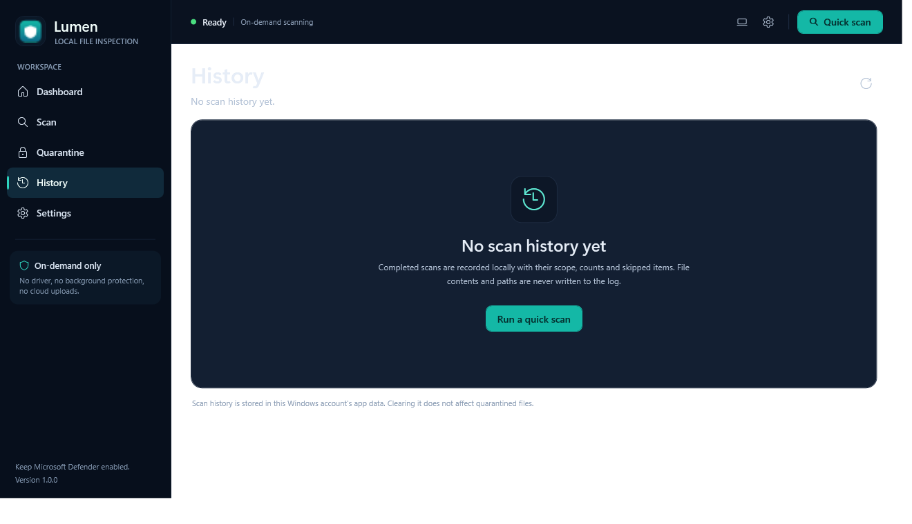

<div align="center">



# Lumen

**A local file inspector for Windows — written by an AI.**

[](https://dotnet.microsoft.com/)
[](https://learn.microsoft.com/dotnet/desktop/wpf/)
[](https://www.microsoft.com/windows)
[](LICENSE)
<br>
[](#detection)
[](#tests)
[](#what-this-is-not)
[](#what-this-is-not)

<sub>One experiment · one model · zero lines of code written by hand</sub>

</div>

[](https://youtu.be/ZeSmtoD2rUI)

<div align="center"><sub><a href="https://youtu.be/ZeSmtoD2rUI">▶ Watch the experiment on YouTube</a></sub></div>

> [!WARNING]
> **This is an experiment, not a security product.**
> Lumen does not protect anything. It has 66 hand-written heuristics and no signature database, so a
> clean result means nothing. It is unsigned, it is not audited, and it was written by a language
> model. **Run it in a disposable virtual machine and keep Microsoft Defender enabled.** No prebuilt
> binary is distributed here: build it yourself, or don't run it at all.



**English** · [Français](#francais)

---

## What this is

Lumen is a small, honest desktop app that looks at files on a Windows machine, tells you *why* it
flagged something, and — if you ask — moves a match into an encrypted vault you can restore later.

It was built as a video experiment: **an AI model was given the whole product, and a human was
allowed to do exactly one thing — complain.** The result is a working WPF application with a real
detection pipeline, a real quarantine vault, a real remediation engine, and a test suite.

It is deliberately unambitious in the places that matter. It is not a driver, it does not hook the
kernel, it never touches the network, and it never silently deletes anything.

## What this is not

- **Not an antivirus.** It is a file inspector with a small, transparent rule set.
- **Not a security boundary.** A file can be written and executed before Lumen finishes looking at it.
- **Not a replacement for Microsoft Defender.** Keep Defender on. Use Lumen next to it, never instead.
- **Not production software.** No installer, no code signing, no auto-update, no telemetry, no support.
- **Not a malware repository.** There is not a single malware sample here. The EICAR test string is
  assembled at runtime from character codes, so cloning this repository does not trip your antivirus.

## The experiment

### The model

Lumen was written by **[MiniMax M3.1 Flash](https://huggingface.co/MiniMaxAI/MiniMax-M3.1-Flash)**
(`MiniMaxAI/MiniMax-M3.1-Flash`).

| | |
|---|---|
| **Architecture** | Native multimodal mixture-of-experts (MoE) |
| **Parameters** | ~428B total · 23B activated per token |
| **Inputs / output** | Text, image and video in; text out |
| **Context window** | Up to 1,000,000 tokens |
| **Attention** | MiniMax Sparse Attention (MSA) throughout the model |
| **Speculative decoding** | DSpark draft head included |

Model card: <https://huggingface.co/MiniMaxAI/MiniMax-M3.1-Flash>

### The rule: I never touched the code

Not once. No editor, no patch, no typo fix, no renamed variable, no missing semicolon. **Every line
in this repository was written by the model.**

My job was everything around the code:

- define the product and the scope;
- run the app and *look* at it;
- describe precisely what broke, with a screenshot or a log;
- choose between the options it proposed;
- say "no, that's wrong, do it again".

It fixed the bugs. I found them.

There was one thing I never delegated: **the machine.** Lumen was never run on my real computer.
Every build, every scan, every crash was reproduced inside a disposable Windows virtual machine with
a snapshot taken first. That is also why this README tells you to do the same — I am not asking you
to trust something I did not trust myself.

### How it actually went

This was not one prompt. The commit history *is* the process: each commit is a round of bug reports
coming back from a running application.

| What broke | How it was found | What the model changed |
|---|---|---|
| The alert window crashed the app on every detection | Ran it in the VM | Rebuilt the alert's animation path |
| An animation kept running behind a collapsed panel — 11% of a core, forever, doing nothing | Measured idle CPU | A test now fails the build if it comes back |
| Two "aggressive" rules fired on ordinary files | Ran the extra rules over 25,126 real files | Both rules tightened before shipping |
| Four interface defects that only exist once the app is actually rendered | First launch on a bare VM | Four fixes, one commit |
| The real-time watcher lost folders it could not access | Watching real download folders | The monitor now heals its own state |

The parts that impress me are the ones I did not ask for: allocation budgets instead of flaky
timing tests, a `DisplayText` sanitiser so a file name cannot spoof the UI with bidirectional
characters, and a hardcoded list of processes Lumen refuses to stop *even if a settings file says
otherwise*.

## Screenshots

Real captures from the running application. No mockups.

| Dashboard | Scan |
|---|---|
|  |  |

| Quarantine | Settings |
|---|---|
|  |  |

| History |
|---|
|  |

## Features

### Scanning — read-only

Four scopes: **Quick** (Desktop, Documents, Downloads), **Full profile** (minus caches, `.git`,
`node_modules`, …), **a folder**, or **a single file**.

Scanning never writes, moves or deletes anything. Remediation is always a separate, explicitly
confirmed decision.

### Real-time protection — detect-on-write

A `FileSystemWatcher` re-inspects new and changed files with the same detectors the manual scan
uses. Three workers by default, six in aggressive mode; a file still being written waits on its own
short deadline instead of blocking the queue.

**This is detect-on-write, not block-on-write.** It is a user-mode watcher, not a kernel filter
driver. A file can be written and executed before the inspection finishes. It only runs while the
app is running.

### Detection

Every rule is documented in `DetectionCatalog.Rules` and rendered on the Settings page, so detection
is never a black box. 66 rules, grouped by what they actually are:

| Category | Meaning |
|---|---|
| `TestSignature` | A harmless industry-standard test artifact (EICAR). Verifies plumbing only. |
| `Signature` | An exact byte or pattern match. |
| `Heuristic` | A combination of suspicious tokens or characteristics. |
| `Behavior` | Packing, obfuscation, suspicious API imports. |
| `Reputation` | A local hash list match. Lumen never performs a network lookup. |

What the rule set actually covers: a data-driven signature engine (ASCII, hex and token-group rules
loaded from JSON), a hand-written portable-executable parser (headers, sections, entropy, import
tables, packing markers, timestamp anomalies), script analysis (LOLBins, PowerShell obfuscation,
AMSI bypass, persistence, AV tampering, credential theft, reverse shells), Office macros and OLE,
PDF analysis (embedded JavaScript, launch actions, embedded executables), archive analysis (nested
archives, password-protected files, zip bombs), Windows shortcuts, entropy and packing heuristics, a
transparent risk score, and a combination scorer that turns several weak signals into one finding
with every contribution listed.

**A clean result is not proof that a file is safe.** The built-in hash list contains exactly one
entry — the EICAR hash. Add your own in `%LOCALAPPDATA%\Lumen\reputation.json`.

### Aggressive mode — off by default

Adds a noisier rule tier: DLL sideloading, anti-analysis and sandbox evasion, shadow-copy deletion,
ransom-note wording, bulk file renames, mining configurations, Office DDE, external template
relationships, PowerShell download cradles, protector sections, a missing import table, an entry
point outside a section, unusual section names.

It also watches the folders a dropper actually lands in — Downloads, the per-user Startup folder and
the per-user temp folder — and can quarantine a high-confidence match without asking.

### Quarantine vault

Copy → verify → **then** delete:

1. The file is encrypted into an AES-256-CBC vault container (`LQ01`: magic ‖ IV ‖ ciphertext).
2. The plaintext SHA-256 and an HMAC-SHA256 over the whole vault file are computed.
3. The manifest entry is written and saved.
4. Only then is the original removed.

Keys are protected with DPAPI (`CurrentUser`) and bound to a single vault item through per-item
entropy, so a key blob cannot be moved between items. A file that changes mid-quarantine is refused,
not deleted. Restore decrypts, verifies the hash, and writes the file back — timestamps included.

### Remediation — opt-in, and always a plan

Off by default. When enabled, Lumen can plan and then execute:

- **terminate the process** holding or running the file (protected and system processes are never
  terminated);
- **permanently remove the file** (only after the hash is re-verified);
- **clean persistence** — `Run`/`RunOnce` values in the current user's hive, Startup-folder items,
  scheduled tasks and services that point at the file;
- **write an audit journal** — an append-only record of everything planned, executed, refused, and
  failed.

Every action is **plan → review → confirm → execute**. The engine fails closed: on any error it
stops, keeps the vault copy, and reports exactly which steps ran.

### Interface

English and French, switchable at runtime without a restart. Light, dark and high-contrast themes.
A detection raises a deliberately loud alert, with an optional sound and an optional cat drawn
entirely with WPF vector geometry — no image files, no fonts, no downloads. A security tool that
takes itself too seriously is a security tool nobody opens.

## Honest limits

| | |
|---|---|
| **Detection** | 66 heuristics. Microsoft Defender has a cloud and a very large signature database. Lumen would lose that fight, and it says so. |
| **Blocking** | It cannot stop a file before it runs. It inspects after the write. |
| **Coverage** | User mode, `asInvoker`, no driver, no service. It cannot see everything and does not pretend to. |
| **Network** | None at all. No hash lookups, no telemetry, no update channel. Old rules stay old. |
| **Trust** | Written by a language model, unsigned, unaudited. Read the source before you run it. |

## Architecture

```
src/Lumen.Core/          net10.0 — no WPF, no Windows-only API except behind interfaces
  Abstractions/          IScanDetector, ILog, IClock, ISecretProtector, …
  Detection/             detectors, signature engine, rule catalogue, PE parser
  Scanning/              ScanEngine, ScanPlanner, ProbeReader, FileProbe
  Protection/            RealtimeMonitor, watcher, response policy
  Quarantine/            QuarantineService, VaultCrypto
  Remediation/           remediation engine, persistence matcher, audit journal
  Storage/               atomic JSON storage, settings, history
  Models/                records and enums
  Util/                  PathRules, HashUtil, DisplayText, formatters

src/Lumen.App/           net10.0-windows — the WPF shell
  Services/              composition root, Windows adapters (process, persistence, DPAPI)
  ViewModels/            MVVM, one per page
  Views/                 one UserControl per page
  Themes/                tokens, palettes, control styles, icons, strings (en/fr)
  Alerts/                the detection alert and the cat
  EasterEggs/            the Konami code and friends

tests/Lumen.Core.Tests/  xunit — the platform-neutral half
tests/Lumen.App.Tests/   xunit — XAML, themes, converters, end-to-end UI

docs/                    video shot list, UI review, screenshots, media
packaging/               scripts and notes for the self-contained build
scripts/                 sandbox run/clean, package, end-to-end verify
```

**Principles**

- **Read-only by default.** Nothing is written, moved or deleted without an explicit, confirmed action.
- **Detectors are pure.** An `IScanDetector` receives a `FileProbe` and performs zero I/O, so the whole
  detection layer is testable with synthetic in-memory data.
- **Paths go through `PathRules`.** Containment, exclusions and system-critical locations are decided
  in one place.
- **Untrusted text goes through `DisplayText`.** File names and error messages are sanitised so they
  cannot spoof the UI with control or bidirectional characters.
- **Contents are never logged.** Hashes, sizes, paths and rule ids are fine. File contents are not.
- **Fail closed.** A corrupt vault, a malformed rule file or a failed write preserves data and reports
  the problem rather than working around it.

## Build and run

Requires the **.NET 10 SDK** (`global.json` pins `10.0.100`, `rollForward: latestFeature`).

```powershell
dotnet build Lumen.slnx
dotnet run   --project src\Lumen.App\Lumen.App.csproj
```

### Run it without touching your real folders

```powershell
.\scripts\run-sandbox.ps1 -Build              # isolated data dir, real-time protection off
.\scripts\run-sandbox.ps1 -Build -Demo        # raise the detection alert on startup
.\scripts\run-sandbox.ps1 -Build -Screenshot  # also capture the screen
.\scripts\clean-sandbox.ps1                   # delete every trace
```

| Variable | Effect |
|---|---|
| `LUMEN_DATA_DIR` | Puts Lumen's data folder here instead of `%LOCALAPPDATA%\Lumen` |
| `LUMEN_DISABLE_REALTIME` | `1` stops the on-access watcher from watching any folder |

| Argument | Effect |
|---|---|
| `--demo` | Raises the detection alert on a harmless sample shortly after startup |
| `--shots <folder>` | Walks every page, saves a PNG of each, then exits |

## Tests

```powershell
dotnet test tests/Lumen.Core.Tests/Lumen.Core.Tests.csproj
dotnet test tests/Lumen.App.Tests/Lumen.App.Tests.csproj
```

**428 test methods, 475 cases.** The suites never touch real user files, real processes, the real
registry or the real application-data folder. Performance is asserted as an **allocation budget**
rather than a wall-clock time, because timing tests are flaky on a loaded machine and an allocation
budget is not.

## Data on disk

```
%LOCALAPPDATA%\Lumen\
├── settings.json                 user settings
├── history.json                  the last 200 scans, newest first
├── quarantine\
│   ├── manifest.json             the vault index
│   └── <32-hex-id>.qbin          one encrypted file per quarantined item
└── logs\
    ├── lumen.log                 diagnostic log (rotated at 2 MiB)
    └── remediation.jsonl         the remediation audit journal
```

Nothing is written to the install folder, to `ProgramData`, or to the registry. A file that cannot be
parsed is preserved beside the original as `<name>.corrupt-<timestamp>` and the user is told.

## Safety notes

- Runs as a normal user, no elevation, no permission bypass. Access-denied results are reported, not
  worked around.
- Installs no driver, service, scheduled task or shell extension.
- Does not change Microsoft Defender settings; it only reads Defender's status.
- Performs no network access of any kind.
- Never removes files from system folders and never stops a protected or system process.

## License

[MIT](LICENSE) — **no warranty**. If it breaks something, that is on you. Read [What this is not](#what-this-is-not)
once more, then run it in a VM.

---

<a id="francais"></a>

## Français

**Un inspecteur de fichiers local pour Windows — écrit par une IA.**

[](https://dotnet.microsoft.com/)
[](LICENSE)
[](#ce-que-ce-n-est-pas)
[](#ce-que-ce-n-est-pas)

> [!WARNING]
> **C'est une expérience, pas un produit de sécurité.**
> Lumen ne protège rien. Il possède 66 heuristiques écrites à la main et aucune base de signatures :
> un résultat propre ne veut donc rien dire. Il n'est pas signé, il n'a pas été audité, et il a été
> écrit par un modèle de langage. **Lancez-le dans une machine virtuelle jetable et gardez Microsoft
> Defender activé.** Aucun binaire prêt à l'emploi n'est distribué ici : compilez-le vous-même, ou ne
> l'exécutez pas.


### Ce que c'est

Lumen est une petite application de bureau honnête qui inspecte les fichiers d'une machine Windows,
explique **pourquoi** elle a signalé quelque chose, et — si vous le demandez — déplace un fichier
correspondant dans un coffre chiffré que vous pourrez restaurer plus tard.

Le projet est né d'une expérience vidéo : **un modèle d'IA a reçu le produit entier, et un humain
n'avait le droit de faire qu'une seule chose : se plaindre.** Le résultat est une application WPF
fonctionnelle, avec un vrai moteur de détection, un vrai coffre de quarantaine, un vrai moteur de
remédiation et une vraie suite de tests.

Il est volontairement modeste là où ça compte : ce n'est pas un pilote, il ne s'accroche pas au
noyau, il ne touche jamais au réseau, et il ne supprime jamais rien en silence.

<a id="ce-que-ce-n-est-pas"></a>

### Ce que ce n'est pas
- **Pas un antivirus.** C'est un inspecteur de fichiers avec un petit jeu de règles transparent.
- **Pas une frontière de sécurité.** Un fichier peut être écrit et exécuté avant que Lumen ait fini
  de le regarder.
- **Pas un remplacement de Microsoft Defender.** Gardez Defender activé. Utilisez Lumen à côté,
  jamais à la place.
- **Pas un logiciel de production.** Pas d'installeur, pas de signature de code, pas de mise à jour,
  pas de télémétrie, pas de support.
- **Pas un dépôt de malwares.** Il n'y a pas un seul échantillon malveillant ici. La chaîne de test
  EICAR est assemblée à l'exécution à partir de codes de caractères : cloner ce dépôt ne déclenchera
  pas votre antivirus.

### L'expérience

**Le modèle.** Lumen a été écrit par **[MiniMax M3.1 Flash](https://huggingface.co/MiniMaxAI/MiniMax-M3.1-Flash)**
(`MiniMaxAI/MiniMax-M3.1-Flash`).

| | |
|---|---|
| **Architecture** | Mixture-of-experts (MoE) multimodale native |
| **Paramètres** | ~428 Md au total · 23 Md activés par token |
| **Entrées / sortie** | Texte, image et vidéo en entrée ; texte en sortie |
| **Fenêtre de contexte** | Jusqu'à 1 000 000 de tokens |
| **Attention** | MiniMax Sparse Attention (MSA) dans tout le modèle |
| **Décodage spéculatif** | Tête de brouillon DSpark incluse |

Fiche du modèle : <https://huggingface.co/MiniMaxAI/MiniMax-M3.1-Flash>

**La règle : je n'ai jamais touché au code.** Pas une fois. Pas d'éditeur, pas de patch, pas de
faute de frappe corrigée, pas de variable renommée, pas de point-virgule manquant. **Chaque ligne de
ce dépôt a été écrite par le modèle.**

Mon travail, c'était tout ce qu'il y a autour :

- définir le produit et le périmètre ;
- lancer l'application et *la regarder* ;
- décrire précisément ce qui casse, avec une capture ou un log ;
- choisir entre les options proposées ;
- dire « non, c'est faux, refais ».

C'est lui qui corrigeait les bugs. C'est moi qui les trouvais.

Une seule chose n'a jamais été déléguée : **la machine.** Lumen n'a jamais tourné sur mon ordinateur
réel. Chaque compilation, chaque analyse, chaque plantage a été reproduit dans une machine virtuelle
Windows jetable, avec un snapshot pris avant. C'est aussi pour ça que ce README vous demande de
faire pareil : je ne vous demande pas de faire confiance à quelque chose auquel je n'ai pas fait
confiance moi-même.

**Comment ça s'est vraiment passé.** Ce n'était pas un seul prompt. L'historique des commits *est*
le processus : chaque commit est un tour de retours de bugs qui viennent d'une application réellement
en cours d'exécution.

| Ce qui cassait | Comment ça a été trouvé | Ce que le modèle a changé |
|---|---|---|
| La fenêtre d'alerte faisait planter l'application à chaque détection | Lancé dans la VM | Chemin d'animation de l'alerte reconstruit |
| Une animation continuait derrière un panneau replié — 11 % d'un cœur, en permanence, pour rien | Mesure du CPU au repos | Un test fait désormais échouer le build si ça revient |
| Deux règles « agressives » se déclenchaient sur des fichiers ordinaires | Passage des règles sur 25 126 vrais fichiers | Les deux règles resserrées avant livraison |
| Quatre défauts d'interface qui n'existent qu'une fois l'application réellement affichée | Premier lancement sur une VM nue | Quatre correctifs, un commit |
| Le surveillant temps réel perdait les dossiers inaccessibles | Observation des vrais dossiers de téléchargement | Le moniteur répare maintenant son propre état |

Les parties qui m'impressionnent sont celles que je n'avais pas demandées : des budgets d'allocation
au lieu de tests de temps instables, un assainisseur `DisplayText` pour qu'un nom de fichier ne
puisse pas usurper l'interface avec des caractères bidirectionnels, et une liste codée en dur de
processus que Lumen refuse d'arrêter *même si un fichier de configuration dit le contraire*.

### Captures d'écran

De vraies captures de l'application en cours d'exécution. Aucune maquette.

| Tableau de bord | Analyse |
|---|---|
|  |  |

| Quarantaine | Réglages |
|---|---|
|  |  |

| Historique |
|---|
|  |

### Fonctionnalités

**Analyse — en lecture seule.** Quatre portées : **rapide** (Bureau, Documents, Téléchargements),
**profil complet** (sans les caches, `.git`, `node_modules`, …), **un dossier**, ou **un seul
fichier**. L'analyse n'écrit, ne déplace et ne supprime jamais rien. La remédiation est toujours une
décision séparée et explicitement confirmée.

**Protection temps réel — détection à l'écriture.** Un `FileSystemWatcher` réinspecte les fichiers
nouveaux et modifiés avec les mêmes détecteurs que l'analyse manuelle. Trois workers par défaut, six
en mode agressif ; un fichier encore en cours d'écriture attend sa propre échéance au lieu de bloquer
la file.

**C'est de la détection à l'écriture, pas du blocage à l'écriture.** C'est un surveillant en mode
utilisateur, pas un pilote de filtre noyau. Un fichier peut être écrit et exécuté avant la fin de
l'inspection. Et ça ne tourne que tant que l'application est ouverte.

**Détection.** Chaque règle est documentée dans `DetectionCatalog.Rules` et affichée dans les
réglages : la détection n'est jamais une boîte noire. 66 règles, classées par ce qu'elles sont
réellement :

| Catégorie | Signification |
|---|---|
| `TestSignature` | Un artefact de test standard et inoffensif (EICAR). Vérifie la plomberie. |
| `Signature` | Une correspondance exacte d'octets ou de motif. |
| `Heuristic` | Une combinaison de jetons ou de caractéristiques suspectes. |
| `Behavior` | Empaquetage, obfuscation, imports d'API suspects. |
| `Reputation` | Correspondance dans une liste de hachages locale. Aucun appel réseau. |

**Un résultat propre ne prouve pas qu'un fichier est sûr.** La liste de hachages intégrée contient
exactement une entrée : celle d'EICAR. Ajoutez les vôtres dans `%LOCALAPPDATA%\Lumen\reputation.json`.

**Mode agressif — désactivé par défaut.** Ajoute une couche de règles plus bruyante : chargement
latéral de DLL, anti-analyse et évasion de sandbox, suppression de copies fantômes, formulation de
notes de rançon, renommages massifs, configurations de minage, DDE Office, modèles externes, chaînes
de téléchargement PowerShell, sections de protecteur, table d'imports absente, point d'entrée hors
section, noms de sections inhabituels. Il surveille aussi les dossiers où atterrit réellement un
dropper — Téléchargements, le dossier Démarrage de l'utilisateur et son dossier temporaire — et peut
mettre en quarantaine une correspondance à haute confiance sans demander.

**Coffre de quarantaine.** Copier → vérifier → **puis** supprimer :

1. Le fichier est chiffré dans un conteneur AES-256-CBC (`LQ01` : magie ‖ IV ‖ texte chiffré).
2. Le SHA-256 du clair et un HMAC-SHA256 sur tout le fichier du coffre sont calculés.
3. L'entrée du manifeste est écrite et sauvegardée.
4. Seulement ensuite, l'original est supprimé.

Les clés sont protégées par DPAPI (`CurrentUser`) et liées à un seul élément du coffre via une
entropie par élément : un blob de clé ne peut pas être déplacé d'un élément à l'autre. Un fichier qui
change pendant la mise en quarantaine est refusé, pas supprimé. La restauration déchiffre, vérifie le
hachage et réécrit le fichier — horodatages compris.

**Remédiation — optionnelle, et toujours un plan.** Désactivée par défaut. Une fois activée, Lumen
peut planifier puis exécuter :

- **arrêter le processus** qui utilise le fichier (les processus protégés et système ne sont jamais
  arrêtés) ;
- **supprimer définitivement le fichier** (seulement après re-vérification du hachage) ;
- **nettoyer la persistance** — valeurs `Run`/`RunOnce` de la ruche de l'utilisateur courant, éléments
  du dossier Démarrage, tâches planifiées et services qui pointent vers le fichier ;
- **écrire un journal d'audit** — une trace en ajout seul de tout ce qui a été planifié, exécuté,
  refusé et échoué.

Chaque action suit **plan → revue → confirmation → exécution**. Le moteur échoue fermé : à la moindre
erreur il s'arrête, garde la copie dans le coffre et indique exactement quelles étapes ont tourné.

**Interface.** Anglais et français, changeables à chaud sans redémarrage. Thèmes clair, sombre et
contraste élevé. Une détection déclenche une alerte volontairement bruyante, avec un son optionnel et
un chat optionnel dessiné entièrement en géométrie vectorielle WPF — aucun fichier image, aucune
police, aucun téléchargement. Un outil de sécurité qui se prend trop au sérieux est un outil de
sécurité que personne n'ouvre.

### Les limites, honnêtement

| | |
|---|---|
| **Détection** | 66 heuristiques. Microsoft Defender a un cloud et une très grosse base de signatures. Lumen perdrait ce combat, et il le dit. |
| **Blocage** | Il ne peut pas arrêter un fichier avant son exécution. Il inspecte après l'écriture. |
| **Couverture** | Mode utilisateur, `asInvoker`, aucun pilote, aucun service. Il ne voit pas tout et ne prétend pas le contraire. |
| **Réseau** | Aucun. Pas de recherche de hachage, pas de télémétrie, pas de canal de mise à jour. Les vieilles règles restent vieilles. |
| **Confiance** | Écrit par un modèle de langage, non signé, non audité. Lisez le code avant de l'exécuter. |

### Architecture

```
src/Lumen.Core/          net10.0 — pas de WPF, aucune API Windows hors interfaces
  Abstractions/          IScanDetector, ILog, IClock, ISecretProtector, …
  Detection/             détecteurs, moteur de signatures, catalogue de règles, parseur PE
  Scanning/              ScanEngine, ScanPlanner, ProbeReader, FileProbe
  Protection/            RealtimeMonitor, surveillant, politique de réponse
  Quarantine/            QuarantineService, VaultCrypto
  Remediation/           moteur de remédiation, correspondance de persistance, journal d'audit
  Storage/               stockage JSON atomique, réglages, historique
  Models/                enregistrements et énumérations
  Util/                  PathRules, HashUtil, DisplayText, formateurs

src/Lumen.App/           net10.0-windows — la coque WPF
  Services/              racine de composition, adaptateurs Windows (processus, persistance, DPAPI)
  ViewModels/            MVVM, un par page
  Views/                 un UserControl par page
  Themes/                jetons, palettes, styles de contrôles, icônes, chaînes (en/fr)
  Alerts/                l'alerte de détection et le chat
  EasterEggs/            le code Konami et compagnie

tests/Lumen.Core.Tests/  xunit — la moitié indépendante de la plateforme
tests/Lumen.App.Tests/   xunit — XAML, thèmes, convertisseurs, interface de bout en bout

docs/                    conducteur vidéo, revue d'interface, captures, médias
packaging/               scripts et notes pour le build autonome
scripts/                 sandbox, packaging, vérification de bout en bout
```

**Principes**

- **Lecture seule par défaut.** Rien n'est écrit, déplacé ou supprimé sans une action explicite et
  confirmée.
- **Les détecteurs sont purs.** Un `IScanDetector` reçoit un `FileProbe` et ne fait aucune E/S : toute
  la couche de détection est testable avec des données synthétiques en mémoire.
- **Les chemins passent par `PathRules`.** Confinement, exclusions et emplacements système sont
  décidés à un seul endroit.
- **Le texte non fiable passe par `DisplayText`.** Noms de fichiers et messages d'erreur sont
  assainis pour ne pas pouvoir usurper l'interface avec des caractères de contrôle ou
  bidirectionnels.
- **Le contenu n'est jamais journalisé.** Hachages, tailles, chemins et identifiants de règles : oui.
  Le contenu des fichiers : non.
- **Échouer fermé.** Un coffre corrompu, un fichier de règles malformé ou une écriture ratée
  préservent les données et signalent le problème au lieu de le contourner.

### Compiler et lancer

Il faut le **SDK .NET 10** (`global.json` épingle `10.0.100`, `rollForward: latestFeature`).

```powershell
dotnet build Lumen.slnx
dotnet run   --project src\Lumen.App\Lumen.App.csproj
```

**Le lancer sans toucher vos vrais dossiers.**

```powershell
.\scripts\run-sandbox.ps1 -Build              # dossier de données isolé, temps réel désactivé
.\scripts\run-sandbox.ps1 -Build -Demo        # déclenche l'alerte de détection au démarrage
.\scripts\run-sandbox.ps1 -Build -Screenshot  # capture aussi l'écran
.\scripts\clean-sandbox.ps1                   # efface toute trace
```

| Variable | Effet |
|---|---|
| `LUMEN_DATA_DIR` | Place le dossier de données ici au lieu de `%LOCALAPPDATA%\Lumen` |
| `LUMEN_DISABLE_REALTIME` | `1` empêche le surveillant de regarder le moindre dossier |

| Argument | Effet |
|---|---|
| `--demo` | Déclenche l'alerte de détection sur un échantillon inoffensif peu après le démarrage |
| `--shots <dossier>` | Parcourt chaque page, enregistre un PNG de chacune, puis quitte |

### Tests

```powershell
dotnet test tests/Lumen.Core.Tests/Lumen.Core.Tests.csproj
dotnet test tests/Lumen.App.Tests/Lumen.App.Tests.csproj
```

**428 méthodes de test, 475 cas.** Les suites ne touchent jamais aux vrais fichiers de l'utilisateur,
aux vrais processus, au vrai registre ni au vrai dossier de données de l'application. La performance
est vérifiée par un **budget d'allocation** plutôt que par un temps d'horloge : les tests de temps
sont instables sur une machine chargée, un budget d'allocation ne l'est pas.

### Données sur le disque

```
%LOCALAPPDATA%\Lumen\
├── settings.json                 réglages utilisateur
├── history.json                  les 200 dernières analyses, les plus récentes d'abord
├── quarantine\
│   ├── manifest.json             l'index du coffre
│   └── <id-32-hex>.qbin          un fichier chiffré par élément en quarantaine
└── logs\
    ├── lumen.log                 journal de diagnostic (rotation à 2 Mio)
    └── remediation.jsonl         le journal d'audit de remédiation
```

Rien n'est écrit dans le dossier d'installation, dans `ProgramData` ni dans le registre. Un fichier
qui ne peut pas être analysé est préservé à côté de l'original sous `<nom>.corrupt-<horodatage>` et
l'utilisateur est prévenu.

### Notes de sécurité

- Tourne en utilisateur normal, sans élévation, sans contourner les permissions Windows. Un accès
  refusé est signalé, pas contourné.
- N'installe aucun pilote, service, tâche planifiée ou extension de shell.
- Ne modifie pas les réglages de Microsoft Defender ; il ne fait que lire son état.
- N'effectue aucun accès réseau, quelle qu'en soit la raison.
- Ne supprime jamais de fichier dans les dossiers système et n'arrête jamais un processus protégé ou
  système.

### Licence

[MIT](LICENSE) — **sans garantie**. Si ça casse quelque chose, c'est pour vous. Relisez
[Ce que ce n'est pas](#ce-que-ce-n-est-pas), puis lancez-le dans une VM.

---

<div align="center">
<sub>
Built with <a href="https://huggingface.co/MiniMaxAI/MiniMax-M3.1-Flash">MiniMax M3.1 Flash</a> ·
Video: <a href="https://youtu.be/ZeSmtoD2rUI">J'ai FORCÉ une IA à CRÉER le MEILLEUR ANTIVIRUS</a> ·
Licence MIT, no warranty
</sub>
</div>
